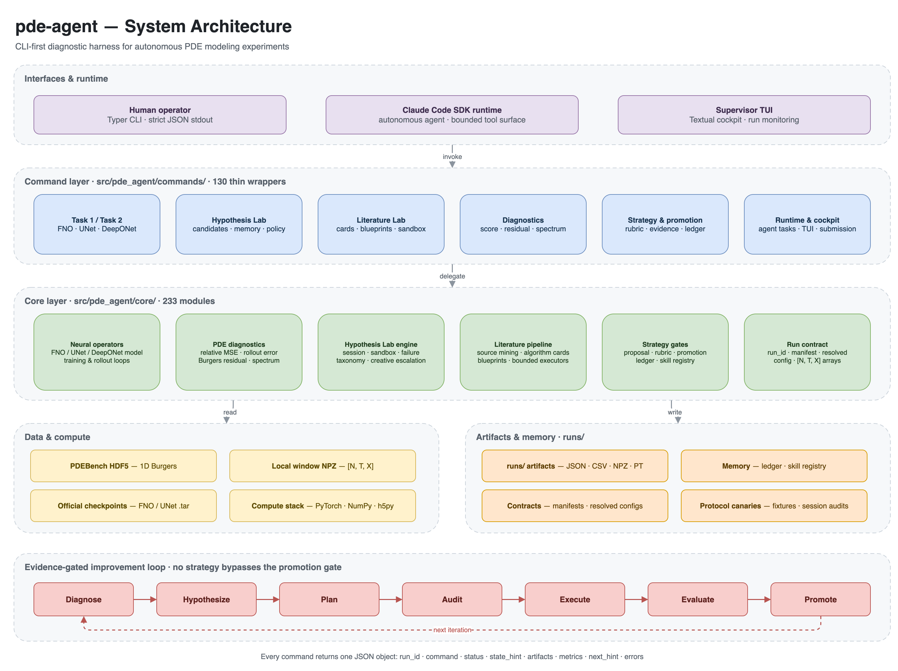

<div align="center">

# pde-agent

**A CLI-first diagnostic harness for autonomous PDE modeling experiments.**

[](https://github.com/daiduo2/pde-agent)


[Overview](#overview) · [Architecture](#architecture) · [Quickstart](#quickstart) · [CLI](#cli-at-a-glance) · [Contracts](#contracts-and-artifacts) · [Development](#development)

</div>

## Overview

`pde-agent` wraps every step of a PDE surrogate-modeling experiment into a
deterministic CLI command that returns machine-readable JSON. It is built around
the PDEBench 1D Burgers benchmark and neural operators such as FNO, UNet, and
DeepONet, but its contracts — window arrays, rollout scoring, physics
diagnostics, and evidence-gated promotion — are model-agnostic.

Instead of a pile of notebooks, you get a loop that an agent can drive and a
human can audit:

```
build a local window → predict → score → diagnose errors and physics
→ propose a bounded next experiment → execute and evaluate candidates
→ promote only what survives a rubric
```

**What makes it different**

- **Contract-first.** One capability maps to one core implementation and one
  thin CLI wrapper. No second business-logic layer.
- **Evidence-gated.** An idea becomes a reusable strategy only after a
  proposal, rubric, promotion report, and ledger entry.
- **Agent-constrained.** Claude Code SDK sessions run behind an allow-listed
  command surface and are checked by executable protocol canaries.
- **JSON-only.** Every command returns the same envelope, so runs are
  resumable, diffable, and easy to chain.

## Architecture

<p align="center">
  
</p>

The system is organized as five layers:

| Layer | Location | Responsibility |
| --- | --- | --- |
| Interfaces | Typer CLI · Claude Code SDK · Textual TUI | Humans and agents enter through one command surface |
| Command layer | `src/pde_agent/commands/` (130 wrappers) | Parse options, call core logic, print one JSON object |
| Core layer | `src/pde_agent/core/` (233 modules) | Training loops, diagnostics, hypothesis/literature engines, contracts |
| Data & compute | PDEBench HDF5 · window NPZ · checkpoints · PyTorch | Shared inputs for every task |
| Artifacts & memory | `runs/` · ledgers · manifests · registries | Reproducible outputs that feed the next iteration |

The diagram source is [`docs/assets/architecture.drawio`](docs/assets/architecture.drawio).
Re-export it after edits with:

```bash
drawio -x -f png -s 2 -o docs/assets/architecture.png docs/assets/architecture.drawio
```

For the full layer model and ownership rules, see
[`docs/repo_contract.md`](docs/repo_contract.md).

## Quickstart

**Prerequisites:** Python 3.12+, [uv](https://docs.astral.sh/uv/), the public
PDEBench Burgers file at
`data/pdebench/burgers/1D_Burgers_Sols_Nu0.001.hdf5`, and — for the operator
adapters — the official `burgers_FNO.tar` / `burgers_Unet.tar` checkpoints under
`data/pdebench/checkpoints/`.

```bash
git clone https://github.com/daiduo2/pde-agent.git
cd pde-agent
uv sync --extra data --extra torch
```

If you still need the dataset, fetch it into place (pass the PDEBench URL):

```bash
uv run --frozen --extra data python scripts/data/download_pdebench_file.py \
  --url "<pdebench-burgers-url>" --progress
```

> **Note:** the training modules import `h5py` eagerly, so invoke the CLI with
> `--extra data` (for example `uv run --frozen --extra data pde-agent --help`).

### 1. Build a local evaluation window

```bash
uv run --frozen --extra data pde-agent build-local-windows \
  --source-path data/pdebench/burgers/1D_Burgers_Sols_Nu0.001.hdf5 \
  --output-path data/derived/local_windows_task1_val.npz \
  --dataset-key tensor \
  --start-index 0 \
  --sample-limit 128 \
  --context-steps 10 \
  --forecast-steps 31 \
  --time-reduction 5 \
  --space-reduction 4
```

For the public Task-1 file, `--time-reduction 5` maps the raw 201 time samples
to 41 reduced steps, so a 10-step context leaves at most 31 local forecast
steps.

### 2. Score a baseline and diagnose it

```bash
uv run --frozen pde-agent generate-baseline-prediction \
  --windows-path data/derived/local_windows_task1_val.npz \
  --output-path data/derived/local_persistence_task1_val.npz \
  --method persistence

uv run --frozen pde-agent score-local-rollout \
  --prediction-path data/derived/local_persistence_task1_val.npz \
  --target-path data/derived/local_windows_task1_val.npz \
  --output-path runs/local_score.json

uv run --frozen pde-agent diagnose-rollout-error \
  --prediction-path data/derived/local_persistence_task1_val.npz \
  --target-path data/derived/local_windows_task1_val.npz \
  --score-path runs/local_score.json \
  --output-path runs/rollout_error_diagnosis.json

uv run --frozen pde-agent check-burgers-physics-local \
  --prediction-path data/derived/local_persistence_task1_val.npz \
  --target-path data/derived/local_windows_task1_val.npz \
  --output-path runs/burgers_physics_check.json \
  --nu 0.001

uv run --frozen pde-agent select-pde-hypothesis \
  --score-path runs/local_score.json \
  --error-diagnosis-path runs/rollout_error_diagnosis.json \
  --physics-check-path runs/burgers_physics_check.json \
  --output-path runs/selected_pde_hypothesis.json
```

Each step consumes the artifacts of the previous one. Nothing is hidden in
process memory; every hand-off is a file path in JSON.

### 3. Run one FNO iteration

Build a small smoke window, then run the evidence-backed local FNO loop:

```bash
uv run --frozen --extra data pde-agent build-local-windows \
  --source-path data/pdebench/burgers/1D_Burgers_Sols_Nu0.001.hdf5 \
  --output-path data/derived/local_windows_task1_smoke.npz \
  --dataset-key tensor \
  --start-index 0 \
  --sample-limit 32 \
  --context-steps 10 \
  --forecast-steps 31 \
  --time-reduction 5 \
  --space-reduction 4

uv run --frozen --extra torch pde-agent run-fno-iteration \
  --windows-path data/derived/local_windows_task1_smoke.npz \
  --checkpoint-path data/pdebench/checkpoints/burgers_FNO.tar \
  --output-dir runs/fno_iteration_001 \
  --max-train-steps 16 \
  --learning-rate 1e-4 \
  --force
```

This runs the dry-run diagnosis, audits the generated experiment config,
executes the scheduled-sampling candidates, evaluates them on the same window,
and writes `fno_iteration_report.json` plus `candidate_comparison.json`.

> Local scores are a proxy for short-horizon iteration. They are **not** the
> hidden 190-step competition evaluator.

### 4. Hand the loop to an agent

```bash
uv run --frozen --extra agent pde-agent run-claude-agent-sdk-runtime \
  --prompt "Diagnose runs/local_score.json and propose the next bounded experiment." \
  --output-path runs/agent_output.json \
  --workspace-dir . \
  --allowed-bash-prefix "uv run --frozen pde-agent"
```

The runtime defaults to read-only tools (`Read`, `Glob`, `Grep`, `Bash`) and
only permits shell commands starting with `uv run --frozen pde-agent`.
`Edit`, `Write`, `NotebookEdit`, and `WebFetch` are denied unless explicitly
enabled.

For a pre-built closed-loop task, use
`build-claude-fno-training-closed-loop-task --workspace-dir . --source-path <hdf5>`
and point `run-claude-agent-sdk-runtime --prompt-file` at the generated prompt.

## CLI at a glance

The CLI exposes **222 commands**. Every command supports `--help` and follows
the same JSON envelope.

| Domain | Representative commands |
| --- | --- |
| Local windows & scoring | `build-local-windows` · `build-local-window-suite` · `score-local-rollout` · `generate-baseline-prediction` |
| Diagnostics & planning | `diagnose-rollout-error` · `check-burgers-physics-local` · `select-pde-hypothesis` · `plan-next-experiment` |
| Neural operators | `inspect-fno-checkpoint` · `predict-fno-local` · `diagnose-fno-rollout` · `run-fno-iteration` · `run-unet-strategy-sweep` · `run-deeponet-strategy-sweep` |
| Hypothesis Lab | `run-hypothesis-lab` · `plan-hypothesis-candidates` · `build-hypothesis-kpi-report` · `build-hypothesis-lab-next-policy` |
| Literature Lab | `run-literature-algorithm-v2-pipeline` · `extract-algorithm-cards` · `compile-algorithm-candidates` · `run-bounded-executor-sandbox` |
| Strategy & promotion | `record-strategy-proposal` · `evaluate-strategy-promotion` · `append-strategy-ledger` · `lookup-strategy-skill` |
| Agent runtime & cockpit | `run-claude-agent-sdk-runtime` · `build-scientific-tool-catalog` · `supervisor-tui-runs` · `cockpit-chat` |

Other verified entrypoints worth knowing:

- **Official operator comparison** — `run-official-operator-comparison`
  ranks the provided FNO/UNet checkpoints against persistence and the spectral
  residual baseline on the same window.
- **Spectral residual baseline** — `train-spectral-residual-baseline` trains a
  NumPy-only ridge residual model for fast, deterministic sanity checks.
- **Agent task contracts** — `build-claude-fno-training-closed-loop-task`,
  `build-claude-hypothesis-lab-closure-task`, and
  `build-claude-literature-candidate-closure-task`.
- **Cockpit** — `supervisor-tui-runs` and `cockpit-chat` provide a Textual UI
  over run state and agent dialogue.

Run `uv run --frozen --extra data pde-agent <command> --help` for exact
options and defaults.

## Contracts and artifacts

### One command, one JSON object

```json
{
  "run_id": "local-score-001",
  "command": "score-local-rollout",
  "status": "ok",
  "state_hint": "LOCAL_ROLLOUT_SCORED",
  "artifacts": {"score_json_path": "runs/local_score.json"},
  "metrics": {"rel_mse": 0.05, "rmse": 0.12},
  "next_hint": "use this score to compare local model variants",
  "errors": []
}
```

- `state_hint` drives the external state machine.
- `artifacts` contains paths the next command may consume.
- `metrics` holds numbers for comparison and evidence tracking.
- `next_hint` is guidance for the agent, not a command string.

### Run directories and manifests

Every run gets a `run_id` and a directory under `runs/<run_id>/`.
`artifacts/manifest.json` is the source of truth for what exists; commands
reference each other through artifact paths rather than hard-coded filenames.

```bash
uv run --frozen pde-agent init-run --run-id demo_001 --runs-root runs
```

### Array contract

Local windows and predictions are NPZ files with rank-3 `[N, T, X]` arrays:

- `context` — known history
- `prediction` / `target` — rollout and ground truth
- metadata must include `problem_id` and `source_mode`

Validate bundles with `core/array_contract.py` before consuming them in new
algorithms.

### Evidence gate

New strategies cannot bypass evaluation:

1. `strategy_proposal.json` — hypothesis, mechanism, plan, observables, risks
2. `experiment_rubric.json` — quantitative evaluation standard
3. `promotion_report.json` — evidence against the rubric
4. `strategy_ledger.jsonl` — success, failure, or revise

Promotion (`promote_to_skill_candidate = true`) only marks a candidate.
Installing a skill or patching model code is a separate audited step.

## Repository layout

```
pde-agent/
├── src/pde_agent/
│   ├── cli.py               # Typer entry point; registers 220+ commands
│   ├── cli_commands/        # 19 domain-grouped command modules
│   ├── commands/            # 130 thin wrappers: parse → core → JSON
│   ├── core/                # 233 modules: algorithms, contracts, state machines
│   └── templates/           # agent-facing prompt and state templates
├── scripts/
│   ├── audit/               # session and protocol audit entrypoints
│   ├── data/                # dataset download and preflight helpers
│   ├── manual/              # explicitly manual diagnostic utilities
│   └── smoke/               # fixture preparation entrypoints
├── integration_tests/       # protocol canaries and agent session fixtures
├── docs/                    # repository, run-state, and runtime contracts
├── tests/                   # 124 pytest files, 1100+ tests
└── runs/                    # generated artifacts (gitignored)
```

## Development

```bash
# Full test suite
uv run --frozen pytest

# A single test file, with optional backends installed
uv run --frozen --extra data --extra torch pytest tests/test_fno_backend_v0.py
```

Before adding a capability:

1. Put reusable behavior in `core/`, not in a script.
2. Add one thin wrapper in `commands/` and register it in `cli.py`.
3. Return the standard JSON envelope via `core/json_output.py`.
4. Add pytest coverage. Torch-dependent tests should skip gracefully.
5. For agent-facing behavior, add an audit and an integration fixture before
   calling it stable.

See [`docs/repo_contract.md`](docs/repo_contract.md) and
[`CLAUDE.md`](CLAUDE.md) for the complete rules.

## Status and scope

- **Research preview.** Interfaces, state hints, and artifact schemas may change.
- **Local scores are proxies.** The hidden evaluator uses the full 190-step
  horizon; short-window improvements are not competition evidence.
- **Checkpoint adapters are bounded.** The official FNO/UNet adapters evaluate
  provided checkpoints; finetuning is a separate, audited path.
- **Claude Code SDK is the active runtime.** Hermes-era documents and artifacts
  remain for compatibility and historical context only.

## Documentation

| Document | What it covers |
| --- | --- |
| [`docs/repo_contract.md`](docs/repo_contract.md) | Layer model, ownership rules, agent workflow discipline |
| [`docs/run_state_contract.md`](docs/run_state_contract.md) | External state machine and state-hint contract |
| [`CLAUDE.md`](CLAUDE.md) | Architecture, command/core split, development rules |
| [`docs/unet-runtime-optimization-plan.md`](docs/unet-runtime-optimization-plan.md) | UNet runtime optimization plan |
| [`docs/hermes_hypothesis_lab_runbook.md`](docs/hermes_hypothesis_lab_runbook.md) | Historical hypothesis-lab runbook |
| [`integration_tests/`](integration_tests/) | Executable protocol fixtures and canaries |

## Acknowledgements

Built on [PDEBench](https://github.com/pdebench/PDEBench) for the Burgers
benchmark, the [Claude Agent SDK](https://github.com/anthropics/claude-agent-sdk-python)
for the autonomous runtime, and [Typer](https://typer.tiangolo.com/),
[uv](https://docs.astral.sh/uv/), [PyTorch](https://pytorch.org/),
[NumPy](https://numpy.org/), [h5py](https://www.h5py.org/), and
[Textual](https://textual.textualize.io/).

<div align="center">
<sub>Built for reproducible, evidence-gated PDE research.</sub>
</div>
